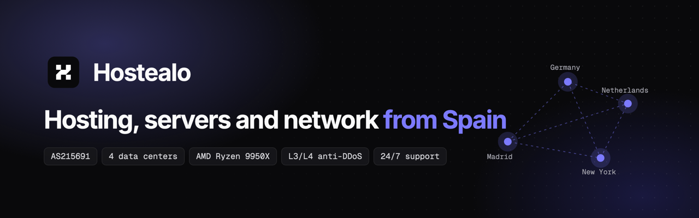

  

  <a href="https://hostealo.com"><b>hostealo.com</b></a> ·
  <a href="https://hostealo.es">hostealo.es</a> ·
  <a href="https://my.hostealo.com">Client area</a> ·
  <a href="https://hostealo.com/contact">Contact</a>

Hostealo is a hosting provider from Spain. We run our own network, **AS215691** (we are a RIPE NCC member), with L3/L4 anti-DDoS in all four of our data centers: Madrid, Germany, the Netherlands and New York. Servers run on AMD Ryzen 9950X with NVMe, and support is there 24/7.

| | |
| --- | --- |
| [VPS](https://hostealo.com/high-performance-vps-spain) | AMD Ryzen 9950X and NVMe, in four data centers |
| [Dedicated servers](https://hostealo.com/dedicated-servers-spain) | Dedicated hardware with live stock |
| [Game servers](https://hostealo.com/gaming-servers) | Minecraft, CS2, Rust and more, with their own panel |
| [Web hosting](https://hostealo.com/web-hosting) and [domains](https://hostealo.com/domains) | Plesk with WordPress Toolkit, in Madrid |
| [Private AI](https://hostealo.com/private-ai) | OpenAI-compatible API on NVIDIA GPUs, in Madrid |
| [Anti-DDoS](https://hostealo.com/services/anti-ddos) and [colocation](https://hostealo.com/colocation) | Protection on every data center; your hardware in Madrid |

This is where we publish the tools we build and use ourselves.

## Hostealo Terminal

**[hostealo-terminal](https://github.com/hostealo-org/hostealo-terminal)**: SSH, SFTP/FTP, remote desktop, Docker and virtual machines in one app for macOS, Windows and Linux, with an AI agent that works on your servers step by step and with your permission. Device sync without a cloud, alerts when a disk fills up, and the public source code. It works with any server, not only ours.

[Download the latest release](https://github.com/hostealo-org/hostealo-terminal/releases)

## Anti-DDoS modules for WHMCS

Manage firewall rules and filters and see the attack history from the WHMCS client area, for hosts protected by these networks.

| Module | Network | License |
| --- | --- | --- |
| [PletX-Module-for-WHMCS](https://github.com/hostealo-org/PletX-Module-for-WHMCS) | [PletX](https://pletx.net) | MIT |
| [NeoProtect-Module-for-WHMCS](https://github.com/hostealo-org/NeoProtect-Module-for-WHMCS) | [NeoProtect](https://neoprotect.net) | MPL-2.0 |
| [Path.net-Module-for-WHMCS](https://github.com/hostealo-org/Path.net-Module-for-WHMCS) | [Path.net](https://path.net) | MPL-2.0 |

---

¿Hablas español? Toda la información está también en <a href="https://hostealo.es">hostealo.es</a>, y nuestro soporte te atiende en español.
